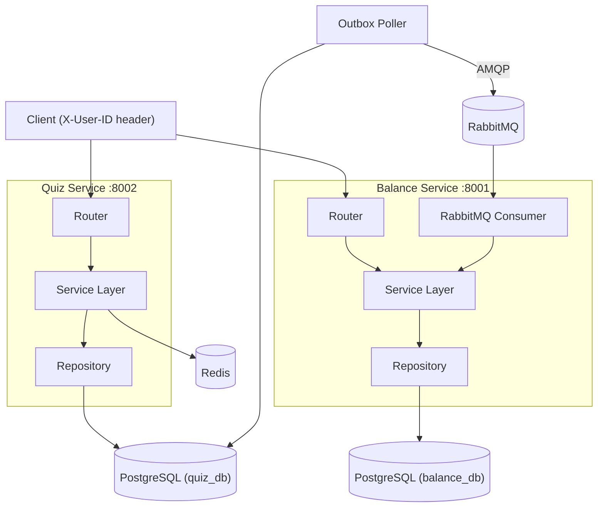
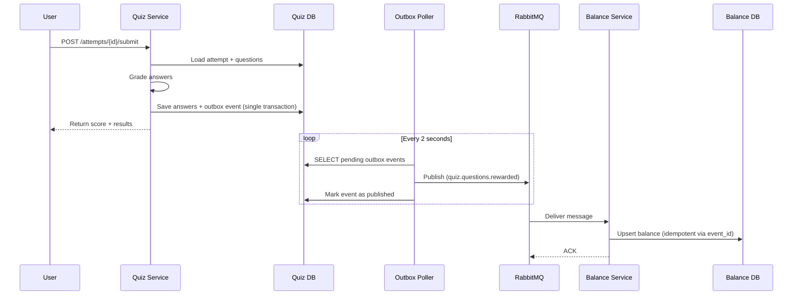
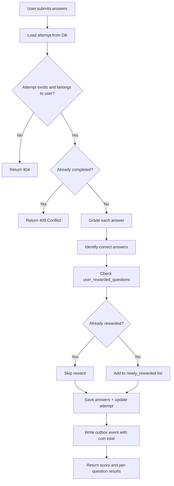

# Finelo -- Quiz & Balance Microservices

Two FastAPI microservices for a financial education platform.
Quiz Service handles quiz CRUD, localization, grading, and reward tracking.
Balance Service manages user virtual currency via event-driven crediting.


## Architecture




## Event Flow: Quiz Completion to Balance Credit




## Quiz Submission and Reward Flow




## Reward Logic

- Each correctly answered question awards 100 balance units.
- If a question was already answered correctly in a previous attempt,
  no additional balance is granted (tracked in user_rewarded_questions).
- The outbox event carries an event_id used as the idempotency_key
  on the balance_transactions table, preventing duplicate credits.


## Question Types

```
  Type              Payload Key          Answer Key
  ---------------------------------------------------------------
  single_choice     correct_id           selected_id
  fill_gap          correct_answers[]    answer (case-insensitive)
  multiple_choice   correct_ids[]        selected_ids[]
  matching          pairs[{id,left,right}]  pairs[{pair_id,matched_pair_id}]
```


## Quick Start

Prerequisites: Docker and Docker Compose.

```bash
git clone <repository-url>
cd ZimranTest
docker compose up --build -d
```

Services will be available at:
- Quiz Service:    http://localhost:8002/docs
- Balance Service: http://localhost:8001/docs
- RabbitMQ UI:     http://localhost:15672 (guest / guest)

The quiz database is automatically seeded with 2 sample quizzes
containing 6 questions (all 4 question types) on first startup.


## Running Tests

```bash
pip install -e shared/
pip install -e "quiz_service[dev]"
pip install -e "balance_service[dev]"

cd quiz_service && pytest -v
cd ../balance_service && pytest -v
```

Or run inside Docker:

```bash
docker compose exec quiz_service pytest -v
docker compose exec balance_service pytest -v
```


## API Endpoints

### Quiz Service (port 8002)

```
GET  /health/live                       Liveness probe
GET  /health/ready                      Readiness (DB + Redis check)

GET  /api/v1/quizzes                    List active quizzes (paginated)
     Query: page, page_size
     Header: Accept-Language (en, de, tr, ...)

GET  /api/v1/quizzes/{quiz_id}          Get quiz detail (localized)
     Header: Accept-Language

POST /api/v1/quizzes                    Create a quiz with questions
     Body: { title: {locale: text}, questions: [...] }

POST /api/v1/attempts/start?quiz_id=    Start a new quiz attempt
     Header: X-User-ID

POST /api/v1/attempts/{id}/submit       Submit answers and get result
     Header: X-User-ID
     Body: { answers: [{ question_id, answer_payload }] }
```

### Balance Service (port 8001)

```
GET  /health/live                       Liveness probe
GET  /health/ready                      Readiness (DB check)

GET  /api/v1/balance                    Get user balance
     Header: X-User-ID

GET  /api/v1/balance/transactions       Transaction history (paginated)
     Header: X-User-ID
     Query: page, page_size
```


## Project Structure

```
ZimranTest/
  docker-compose.yml
  Makefile
  README.md
  shared/
    shared/
      __init__.py
      exceptions.py         Domain exceptions
      logging.py             Structured logging (structlog)
      schemas.py             Event envelope + QuizRewardEvent
      messaging/
        base.py              Abstract MessagePublisher / MessageConsumer
        rabbitmq.py          RabbitMQ implementation
        kafka.py             Kafka implementation (swappable)

  quiz_service/
    alembic.ini
    pyproject.toml
    Dockerfile
    migrations/              Alembic migrations + seed data
    src/
      app.py                 FastAPI application setup
      lifespan.py            Startup/shutdown (Redis, RabbitMQ, Outbox poller)
      config/                Pydantic settings (database, redis, cors, etc.)
      libs/base_model.py     SQLAlchemy Base + TimestampMixin
      dependencies/          FastAPI dependency injection (ISession, IRedis, IUserID)
      quiz/
        models/quiz.py       Quiz, Question ORM models
        entities.py          Domain entities (QuizEntity, QuestionEntity)
        dto.py               Pydantic request/response schemas
        repositories/        Data access layer
        service/quiz.py      Business logic (localization, cache, CRUD)
        dependencies/        DI for QuizService, QuizRepository
      attempt/
        models/attempt.py    QuizAttempt, UserQuestionAnswer, OutboxEvent ORM
        entities.py          Domain entities
        dto.py               Request/response schemas
        repositories/        Data access (attempt + outbox)
        service/
          attempt.py         Submission, grading orchestration, reward logic
          grading.py         Stateless answer checker (all 4 question types)
        dependencies/        DI for AttemptService, repos
      health/router.py       Health check endpoints
    tests/
      conftest.py
      unit/
        test_grading_service.py       Grading logic (16 tests)
        test_attempt_service.py       Submission flow (3 tests)
        test_quiz_service.py          Quiz CRUD, cache, localization (13 tests)
        test_shared_schemas.py        Event serialization (6 tests)

  balance_service/
    alembic.ini
    pyproject.toml
    Dockerfile
    migrations/              Alembic migrations
    src/
      app.py                 FastAPI application setup
      lifespan.py            Startup/shutdown (RabbitMQ consumer)
      config/                Pydantic settings
      libs/base_model.py     SQLAlchemy Base
      dependencies/          FastAPI dependency injection
      balance/
        models/balance.py    Balance, BalanceTransaction ORM models
        entities.py          Domain entities
        dto.py               Request/response schemas
        repositories/        Data access (upsert with idempotency)
        service/balance.py   Business logic
        consumer.py          RabbitMQ message handler
        dependencies/        DI for BalanceService, repo
      health/router.py       Health check endpoints
    tests/
      conftest.py
      unit/
        test_balance_service.py            Credit logic (3 tests)
        test_balance_service_edge_cases.py Edge cases (6 tests)
        test_consumer.py                   Message handler (3 tests)
```


## Key Design Decisions

Localization: JSONB columns storing {locale: text} maps. Client sends
Accept-Language header, server extracts primary locale and falls back
to English if the requested locale is unavailable.

Question types: Single questions table with a type enum and a JSONB
payload column. Each type defines its own payload shape. This avoids
extra tables while keeping the schema flexible.

Reward idempotency: A composite primary key (user_id, question_id) in
user_rewarded_questions prevents duplicate rewards across attempts.

Event delivery: Transactional Outbox pattern. The outbox event is
written in the same database transaction as the business data. A
background poller publishes events to RabbitMQ independently.

Balance idempotency: The event_id from the outbox is used as the
idempotency_key (UNIQUE constraint) on balance_transactions, preventing
duplicate credits even if the same message is delivered twice.

Dead letter queue: Failed messages are nack'd to a DLQ
(balance.quiz_reward.dlq) for manual inspection.


## Seed Data

The quiz database includes two pre-loaded quizzes with test data:

Quiz 1 -- "Crypto Basics" (4 questions, one of each type):
  - Single Choice: "What is Bitcoin?"
  - Fill the Gap: "The creator of Bitcoin is known as ___"
  - Multiple Choice: "Which are cryptocurrencies?"
  - Matching: "Match the crypto to its ticker"

Quiz 2 -- "Investment 101" (2 fill-gap questions):
  - "An ETF stands for Exchange-Traded ___"
  - "Diversification reduces ___"

All questions are localized in English, German, and Turkish.


## Supported Languages

en, de, tr, fr, it, id, tl, es, pt -- extensible via JSONB fields.


## Environment Variables

Each service reads configuration from environment variables.
See docker-compose.yml for the full list. Key variables:

```
DB_HOST, DB_PORT, DB_NAME, DB_USER, DB_PASSWORD
RABBITMQ_URL
REDIS_URL           (quiz_service only)
APP_PORT
```


need to deep analyze to check project code, find critical moments and answer why what and how to fix it

you can refactor parts that you think should be


but your main goal is to write tests for each service, for balance and quiz services, need to cover all edge cases, need to write tests such that after they completion be fully sure everything correct and nothing can broke project

tests location in tests dir
like:
balance_service/tests/

in tests likely to see also 3 dirs
e2e/
unit/
integration/


for every service like 100 tests that covers every edge case, every funcionality, every aspect of code, and give sure for service
for shared dir as you much as you want

write following best practices and industry standard, 
i want to see enterprise level 

also analyze setup, docker files, how everything attached and worked, maybe in devops part need to change something


